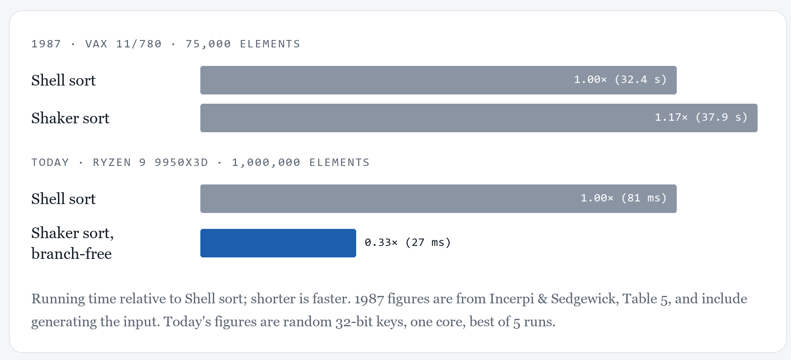

# THIS IS NOT A REPO MEANT FOR MY USUAL CASUAL CROWD. THIS IS FOR THE HARDCORE MATH/CS/SCIENTIST COMMUNITY. I THOUGHT MAYBE I'D GET FREE PUBLICITY OR SOMETHING LIKE THAT FROM RESPECTABLE PEOPLE FOR THIS. AND NO, I DON'T UNDERSTAND THE TECHNICAL STUFF, BUT I KNOW THOSE GUYS DO. I KNOW THIS CONTENT IS THE KIND OF STUFF THEY NORMALY READ. ACTUAL LEGITIMATE PEOPLE. 
# utah_sort

In 1987, a Shellsort variant called **shaker sort** ran about 15% slower than
a well-tuned Shellsort on a VAX 11/780. Written branch-free and run on a
current CPU, the same algorithm is **about 3× faster** than Shellsort.



This repo has the benchmark (Rust, no dependencies), reference
implementations and correctness tests (Python), and the raw results.

It started as an AI-generated "new" sorting algorithm called Utah Sort. That
turned out to be the 1987 algorithm plus three additions that don't help, and
the 1987 algorithm itself was the interesting part.
[More on that below.](#what-about-utah-sort)

## The result

Sorting 1,000,000 random `u32` keys on one core of an AMD Ryzen 9 9950X3D
(best of 5 runs):

| Algorithm | Time |
|---|---:|
| Shellsort, Ciura gaps | 81 ms |
| Shaker sort (1987), compare-exchange with a branch | 81 ms |
| **Shaker sort (1987), branch-free compare-exchange** | **27 ms** |
| Rust `slice::sort_unstable`, for reference | 9.4 ms |

At 10,000,000 keys: 1,005 ms, 984 ms, **318 ms** and 109 ms. These come from
[`main-u32.md`](results/ryzen-9-9950x3d/main-u32.md), the current code. An
earlier build measured 24 ms (3.4×) for the branch-free row; that turned out
to be a lucky code layout ([details](#other-key-types)).

The second and third rows are the same algorithm with the same gaps. The only
difference is how one compare-exchange is written:

```rust
// with a branch
if v[i] > v[j] { v.swap(i, j); }

// branch-free: min/max compile to cmov (or SIMD min/max)
let (a, b) = (v[i], v[j]);
v[i] = a.min(b);
v[j] = a.max(b);
```

For comparison, the 1987 paper (Table 5) reports 37.9 s for shaker sort and
32.4 s for Shellsort at n = 75,000 on a VAX 11/780.

All inputs and sizes are in [`results/`](results/ryzen-9-9950x3d/). Shaker
sort is not faster everywhere. On already-sorted input, Shellsort takes 6 ms
and branch-free shaker sort takes 26 ms, because shaker sort does the same
work no matter what the input looks like.

## Why, probably

Shellsort's inner loop,

```rust
while j >= g && v[j - g] > t { v[j] = v[j - g]; j -= g; }
```

exits at a point that depends on the data. On random input the CPU's branch
predictor often guesses wrong, and each wrong guess throws away a dozen or
more cycles of work.

Shaker sort's passes do the same sequence of compare-exchanges whatever the
data is. In the Python comparison count, it makes exactly 4,164,391
comparisons at n = 100,000 on *every* input pattern. The passes leave the
array fully sorted, so the final insertion pass only confirms it. That is 1.6×
the comparisons Shellsort makes on random input, but written branch-free,
each one is a conditional move with nothing to mispredict.

**It isn't SIMD.** With `target-cpu=native`, LLVM auto-vectorizes the
branch-free passes with AVX-512. With vectorization turned off
(`-C no-vectorize-loops -C no-vectorize-slp`), the assembly is scalar `cmov`.
In that comparison (commit `d420208`), shaker sort took 24 ms at 1M both with
and without SIMD, so vectorization isn't what makes it fast. See
[`main-no-simd.md`](results/ryzen-9-9950x3d/main-no-simd.md).

**Not yet confirmed.** I haven't measured branch mispredictions with hardware
counters. If you're on Linux, this would settle it:

```sh
cd rust
RUSTFLAGS="-C target-cpu=native" cargo build --release
perf stat -e branches,branch-misses ./target/release/utah_bench --only shellsort
perf stat -e branches,branch-misses ./target/release/utah_bench --only shaker_branchless
```

Each `--only` run sorts 1M random keys 10 times. The counts also include
generating the input and one reference sort, which are the same for both.

## Other key types

The headline is for `u32`. `cargo run --release -- --keys u64` (or `f64`,
`str`) runs the same table with other keys, built from the same input
patterns. 1M random keys, all from one build:

| Keys | Shellsort | shaker, with a branch | shaker, branch-free | branch-free vs. Shellsort |
|---|---:|---:|---:|---:|
| `u32` | 81 ms | 81 ms | 27 ms | 3.1× faster |
| `u64` | 82 ms | 83 ms | 25 ms | 3.3× faster |
| `f64`, `total_cmp` order | 123 ms | 100 ms | 44 ms | 2.8× faster |
| 8–24-byte strings (`&[u8]`) | 338 ms | 448 ms | 405 ms | 1.2× **slower** |

- **`u64`: the result holds.** 3.3× at 1M keys, 3.4× at 10M.
- **`f64`: it shrinks** to 2.8× at 1M (3.0× at 10M). Both sorts compare with
  `total_cmp`, which turns each float into an integer before comparing. That
  slows both down, and branch-free shaker sort still wins clearly.
- **Strings: it disappears.** Shellsort is 1.2× faster at 1M and 1.6× faster
  at 10M. Each comparison is a `memcmp` call through two pointers, and that,
  not the branch, is most of the cost: removing the branch saves only 10% at
  1M (448 → 405 ms). Shaker sort makes 1.6× as many comparisons (at 100k
  keys), so it loses. At 10M it is even slower than shaker sort with a
  branch (12.6 s vs 10.4 s), probably because the branch lets the CPU start
  the next loads before the comparison finishes.

The first published numbers (commit `d420208`) had 24 ms for branch-free
shaker sort on `u32`, which is 3.4×. The inner loop compiles to the same
instructions in that build and the current one. With loops forced to 64-byte
alignment, both take 26.4 ms, so 24 ms was a lucky code layout. The headline
table now uses the current build. More in
[`docs/details.md`](docs/details.md#other-key-types).

## What about Utah Sort?

An AI tool proposed "Utah Sort" as a new algorithm and presented its pieces
as new. When checked, the core turned out to be shaker sort from
[Incerpi & Sedgewick (1987)](https://sedgewick.io/wp-content/themes/sedgewick/papers/1987Practical.pdf).
Its three additions:

1. a **mirror pass** first: compare-exchange `A[i]` with `A[n-1-i]`;
2. an **insertion pass after every gap**, not just at the end;
3. a **shrinking window**: track the outermost swaps of each pass and only
   insertion-sort between them. The backward pass leaves each chain's minimum
   at the left edge, so the insertion loop needs no bounds check.

All three are correct. The proofs are in [`docs/details.md`](docs/details.md),
and `python/check_correctness.py` checks them on 695,129 inputs using a list
that refuses negative indices. They don't make it faster on random data
(branch-free, 1M keys, range over three runs of commit `d420208`):

| Variant | Time |
|---|---:|
| Utah Sort, all three additions | 38–39 ms |
| without the mirror pass | 41–43 ms |
| without the window too (shake + insert at every gap) | 37 ms |
| same, with the 1987 gaps | 35 ms |
| shake at every gap, insert once at the end, Ciura gaps | 223–225 ms |
| **shaker sort (1987): 1987 gaps, insert once at the end** | **24–25 ms** |

With both the mirror pass and the window, Utah Sort is no faster than plain
shake-and-insert (38 vs 37 ms). Individually they move the time about 10% in
opposite directions, and the mirror pass's effect reversed sign in an earlier
build, so I wouldn't read much into either. The real cost is inserting after
every gap: about 1.4× (35 vs 24 ms). Shaker sort also needs its denser 1.7×
gap sequence. With Shellsort's gaps, a single shake per gap leaves too much
work for the final insertion. The additions only pay off on input that is
already sorted or exactly reversed, where Utah Sort takes 4 ms.

## Caveats

- One machine, one core. The headline is for `u32`. `u64` and `f64` give
  similar speedups, and strings don't
  ([Other key types](#other-key-types)).
- Code layout matters. Two builds with identical inner-loop instructions gave
  3.4× and 3.1× for the headline, and some other cells have moved by up to a
  third. Treat small differences between builds as noise.
- Each algorithm uses the gap sequence its own literature recommends.
- The standard library's sort is still about 3× faster than branch-free shaker
  sort. This matters only where you'd pick Shellsort anyway: tiny code, no
  allocation, no standard library.
- If the explanation is right, the speedup depends on a deep, speculative
  pipeline. Small in-order microcontrollers may behave more like the VAX did.
  That's untested.
- I haven't done an exhaustive literature search. If this has been published,
  please open an issue and I'll credit it here.

## Run it

Rust (stable, 1.88 or newer, no dependencies):

```sh
cd rust
export RUSTFLAGS="-C target-cpu=native"
cargo run --release                # main table, about a minute
cargo run --release -- --keys f64  # same with u64, f64 or str keys (default u32)
cargo run --release -- --ablate    # Utah Sort ablation, about two minutes
cargo run --release -- --list      # algorithm names for --only
```

On Windows PowerShell, use `$env:RUSTFLAGS="-C target-cpu=native"` instead
of `export`.

Python (3.8+, standard library only):

```sh
cd python
python check_correctness.py   # a few minutes
python count_comparisons.py
```

## Help wanted

- **Other machines.** Intel, Apple Silicon and other ARM chips, older x86, a
  Raspberry Pi, a microcontroller. Open an issue with your CPU model and the
  output of the main table and `--ablate`, and if you can, `--keys u64`,
  `f64` and `str`.
- **`perf stat` numbers** for the two commands above.
- **Prior art** for the branch-free result.

## Layout

```
python/sorts.py              Shellsort, shaker sort, Utah Sort (reference versions)
python/check_correctness.py  exhaustive and random correctness tests
python/count_comparisons.py  comparison counts for all three
rust/src/main.rs             timing benchmark and ablation
results/                     raw output and machine details
docs/details.md              algorithms, Utah Sort proofs, full tables, references
```

## How this was made

The "Utah Sort" proposal came from a generative AI tool. I used Claude, an
AI coding assistant, to check it against the literature and to write the
tests, the benchmark and this README. Every number here comes from running the
code in this repo, and you can rerun it yourself.

## References

- J. Incerpi, R. Sedgewick. [Practical variations of Shellsort](https://sedgewick.io/wp-content/themes/sedgewick/papers/1987Practical.pdf). *Information Processing Letters* 26(1):37–43, 1987.
- D. L. Shell. A high-speed sorting procedure. *Communications of the ACM* 2(7):30–32, 1959.
- M. Ciura. Best increments for the average case of Shellsort. *FCT 2001*.
- S. Edelkamp, A. Weiß. BlockQuicksort: Avoiding branch mispredictions in quicksort. *ESA 2016*.
- W. Dobosiewicz. An efficient variation of bubble sort. *IPL* 11(1):5–6, 1980.
- D. E. Knuth. *The Art of Computer Programming, Vol. 3*, §5.2.1–5.2.2.

## License

MIT
